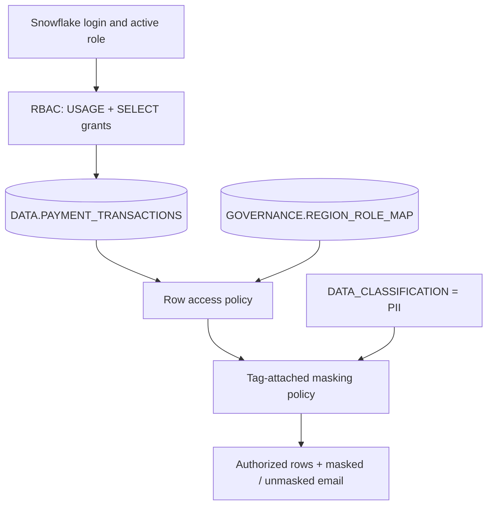

# Snowflake RBAC & ABAC Security Lab — Payment Transactions

A GitHub-ready, hands-on access-control project built around **synthetic payment transactions**. Demonstrates least-privilege roles, region-based row authorization, PII column masking, and tests using Snowsight SQL worksheets.

> **Edition warning:** Native row access policies, dynamic masking, and tag-based masking need **Snowflake Enterprise Edition or higher**. An account on the free *trial* can run this full track if the trial is Enterprise. On Standard Edition, use the `sql/standard/` secure-view fallback, which is **not native ABAC**. No paid upgrade is required just to run the Standard demonstration.

## Project outcomes

| Persona / role | Expected row visibility | Email visibility |
|---|---|---|
| `DEMO_US_ANALYST` | US only (3) | `***MASKED***` |
| `DEMO_EU_ANALYST` | EU only (3) | `***MASKED***` |
| `DEMO_AUDITOR` | All regions (8) | `***MASKED***` |
| `DEMO_COMPLIANCE` | All regions (8) | Original synthetic emails |

Source records: 8 (US=3, EU=3, APAC=2). This table describes **expected** results until the SQL is executed in a live account.

## Architecture



## Prerequisites

1. Snowflake trial or account and Snowsight SQL Worksheets.
2. Permissions to switch to `SYSADMIN` and `SECURITYADMIN`, with ownership / policy privileges in your isolated account.
3. Choose your edition track below. Run in **a personal, disposable lab only**; scripts create/drop objects.
4. No cloud storage integrations, credentials, or actual customer records needed.

## Track A — Enterprise trial/full native RBAC + ABAC

In Snowsight open **Projects → Worksheets**. Copy and execute **one file at a time, in this exact order**:

| Step | File | Run as | Purpose |
|---|---|---|---|
| 0 | `sql/00_preflight.sql` | accessible role | identify username / version |
| 1 | `sql/01_infrastructure.sql` | `SYSADMIN` | warehouse, database, 8 transactions, region-role map |
| 2 | `sql/02_roles_and_grants.sql` | `SECURITYADMIN` | create/grant roles |
| 3 | `sql/03_row_access.sql` | `SYSADMIN` | region-based row access |
| 4 | `sql/04_abac_tag_masking.sql` | `SYSADMIN` | PII tag + tag-attached masking |
| 5 | Edit role grants in `02_roles_and_grants.sql` | `SECURITYADMIN` | assign demo roles to *your user* |
| 6 | `sql/07_validation_enterprise.sql` | each test role | positive assertions |
| 7 | `sql/05_test_cases.sql` | each test role | detailed queries and negative tests |

**Important user-grant step:** Run `SELECT CURRENT_USER();` and replace `YOUR_SNOWFLAKE_USERNAME` in the **four commented-out `GRANT ROLE ... TO USER` commands** of `02_roles_and_grants.sql`. Uncomment/run just those four commands under `SECURITYADMIN`. You must be able to switch to a role before `USE ROLE` succeeds.

**Policy behavior:** The role-map policy uses `IS_ROLE_IN_SESSION(...)` to authorize rows. Admins/auditors/compliance can access all eight; analysts see their own region. The email mask checks whether its column tag says `PII` and whether the session inherits `DEMO_PII_READER` or is administrator. Compliance inherits PII-reader; auditor does not. Run `USE SECONDARY ROLES NONE` for role-switching tests.

**Run setup once against a fresh lab.** `CREATE OR REPLACE TABLE` wipes prior sample contents and policy attachment. Never run these scripts against real data.

## Track B — Standard Edition RBAC + secure views

This runs without native row access or tag-based masking. It's a practical **RBAC and secure-view simulation**, *not* actual Snowflake ABAC.

1. Run `sql/00_preflight.sql`, then `sql/01_infrastructure.sql`.
2. Run `sql/standard/01_secure_views.sql` as `SYSADMIN`.
3. Run `sql/standard/02_secure_view_grants.sql` as `SECURITYADMIN`.
4. In that file, replace `YOUR_SNOWFLAKE_USERNAME` in four commented `GRANT ROLE` statements. Uncomment/run those four.
5. Run `sql/standard/03_secure_view_tests.sql`.
6. Optionally clean up with `sql/standard/04_cleanup_standard_roles.sql`, then `sql/06_cleanup_optional.sql`.

**Do not run** enterprise files `02_roles_and_grants.sql`, `03_row_access.sql`, or `04_abac_tag_masking.sql` on this track, because `02` grants SELECT on the underlying table and would bypass the Standard-track secure views.

## Validations and evidence

Follow [`docs/DEMO_WALKTHROUGH.md`](docs/DEMO_WALKTHROUGH.md) for a 10–15 minute live walkthrough and screenshot checklist. Save redacted images under `assets/screenshots/`.

Check privileges:
```sql
SHOW GRANTS TO ROLE DEMO_US_ANALYST;
SHOW ROW ACCESS POLICIES IN SCHEMA RBAC_ABAC_DEMO.GOVERNANCE;
SHOW MASKING POLICIES IN SCHEMA RBAC_ABAC_DEMO.GOVERNANCE;
SHOW TAGS IN SCHEMA RBAC_ABAC_DEMO.GOVERNANCE;
```
The last three commands are for Enterprise. Static repository checks run with:
```bash
python3 -m unittest discover -s tests -v
```
**These are static checks, not a live Snowflake integration test.** The GitHub Actions workflow executes only those checks and requires no Snowflake credentials.

## GitHub upload

Create a **new public repository** named `snowflake-rbac-abac-payment-security`, preferably without auto-creating a README. Open a terminal in the extracted project folder:

```bash
git init
git add .
git commit -m "Build Snowflake RBAC and ABAC payment security lab"
git branch -M main
git remote add origin https://github.com/YOUR_GITHUB_USERNAME/snowflake-rbac-abac-payment-security.git
git push -u origin main
```

Replace `YOUR_GITHUB_USERNAME` with your GitHub username. Or drag/drop the extracted project folders into GitHub **Add file → Upload files**. Do not push raw unredacted Snowsight screenshots, secrets, `.env` files, or account-identifying information.

## Repository structure

```text
sql/
  00_preflight.sql
  01_infrastructure.sql
  02_roles_and_grants.sql
  03_row_access.sql
  04_abac_tag_masking.sql
  05_test_cases.sql
  06_cleanup_optional.sql
  07_validation_enterprise.sql
  standard/
    01_secure_views.sql
    02_secure_view_grants.sql
    03_secure_view_tests.sql
    04_cleanup_standard_roles.sql
docs/
  DEMO_WALKTHROUGH.md
  TROUBLESHOOTING.md
assets/screenshots/
tests/
.github/workflows/checks.yml
README.md
LICENSE
.gitignore
```

## Security and cost notes

- All sample data is fictional; emails use `example.com`.
- Roles assigned to a single tester are for lab convenience only. In production, use distinct users with least privilege.
- The demonstration exempts privileged SYSADMIN from policies; this is for troubleshooting, not an enterprise security blueprint.
- Protect governance mapping-table access; separate table ownership, policy ownership, and grant administration for production.
- The warehouse is `XSMALL`, `AUTO_SUSPEND=60`, `AUTO_RESUME=TRUE`. Query execution still consumes trial credits.
- `sql/06_cleanup_optional.sql` **deletes the entire demo database and warehouse**. Use only after capturing evidence.

## Snowflake documentation

- [Access control](https://docs.snowflake.com/en/user-guide/security-access-control-overview)
- [Row access policies](https://docs.snowflake.com/en/user-guide/security-row-intro)
- [Dynamic data masking](https://docs.snowflake.com/en/user-guide/security-column-ddm-intro)
- [Tag-based masking](https://docs.snowflake.com/en/user-guide/tag-based-masking-policies)
- [Object tagging](https://docs.snowflake.com/en/user-guide/object-tagging/introduction)

## License

MIT — see [LICENSE](LICENSE).
